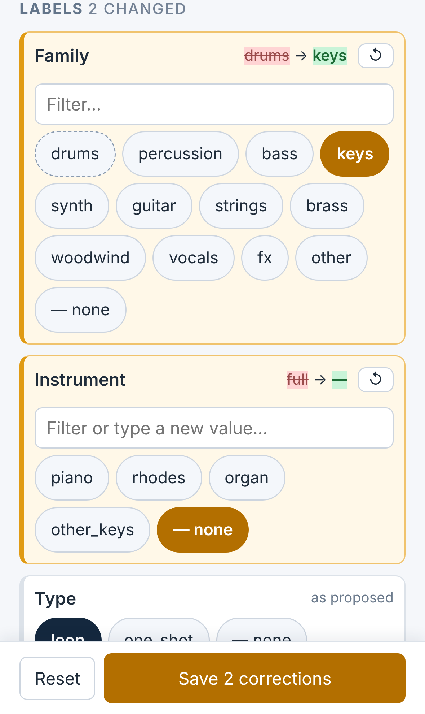

# hil-eval

> Working name. Status: pre-alpha.

Add **human-in-the-loop review** to AI outputs in a few lines: a judge scores every
output, and only low-confidence items (plus a small random audit sample) land in a
local review queue backed by SQLite. Images are stored content-addressed by SHA-256.

## Install (from source)

```bash
uv sync            # or: pip install -e .   (add [image] for Pillow support)
```

## Example

```python
import hil_eval as hil

hil.init(project="demo", store="sqlite:///.hil/hil.db")


def judge(inputs, output):
    return hil.Judgment(confidence=0.4 if "?" in output else 0.95, reason="hedged answer")


@hil.review(judge=judge, threshold=0.8, audit_rate=0.0)
def answer(question: str) -> str:
    return "Maybe 42?" if "life" in question else "Paris"


answer("capital of France")  # high confidence -> not queued
answer("meaning of life")  # low confidence  -> queued for review
print([(i.input, i.output, i.routed_by.value) for i in hil.list_items()])
```

The decorated function's return value is always passed through unchanged; judge or
storage failures are logged and never break your app (fail-open). Async functions work too.

- `threshold="auto"` uses the project's stored threshold (falls back to 0.8).
- `images=["image"]` explicitly marks media arguments (string paths, bytes, PIL) stored by SHA-256.
- Audio bytes and existing audio `Path` inputs are captured automatically. WAV, MP3
  (ID3 or MPEG frame sync), FLAC, Ogg, and AIFF are detected by signature; file
  extensions are a fallback. Plain string paths require `images=["argument"]`.
- `assets=[...]` marks media anywhere in arguments **or the return value** with
  selectors: `"audio"` (argument), `"output.audio"`, `"output[*].path"`,
  `"output.results[*].path"` (`[*]` maps lists, `[N]` indexes; missing keys are
  skipped). Selected string paths become assets without converting to `Path`, and
  each asset's `order` follows list position, so UI and Parquet order match rank.
  `images=` remains as a backward-compatible alias.
- `name="search_text"` overrides the recorded `fn_name` (useful for closures,
  whose `__qualname__` contains `<locals>`).
- `route="all"` queues every call (recorded as `routed_by=manual`, so threshold
  tuning ignores these rather than mis-weighting them); the default
  `route="confidence"` keeps threshold + audit routing.
- `audit_rate` routes a random fraction of high-confidence items for unbiased tuning.
- `hil.submit(input=..., output=..., confidence=...)` enqueues an item manually;
  it accepts the same `assets=` selectors (rooted at `input` or `output`) and `name=`.

```python
@hil.review(judge=score_judge, route="all", name="search_text", assets=["output[*].path"])
def search(query: str, k: int = 5) -> list[dict]:
    return [{"rank": i + 1, "path": str(p)} for i, p in enumerate(find(query, k))]
```

Supply choice labels with `options` for choice review:

```python
@hil.review(judge=judge, options=["positive", "negative"])
def classify(text):
    return model(text)


# Dynamic choices receive the original positional args, keyword args, and result.
@hil.review(judge=judge, options=lambda args, kwargs, result: [result, "other"])
def suggest(text):
    return model(text)


hil.submit(input="Pick a color", output="red", options=["red", "blue"])
```

The callback may return `None` to omit choices. It runs only when an item is queued;
errors are logged without changing the function's result. Choices come from the
`options` parameter, not the judge.

See `docs/` for the design and roadmap (Japanese).

## Development

```bash
uv sync && uv run pytest && uv run ruff check . && uv run ruff format --check .
```

## License

MIT

## Review UI and HTTP API

```bash
pip install 'hil-eval[server,image]'
python examples/demo_review.py --db .hil/hil.db
hil-eval serve --db .hil/hil.db
# Open http://127.0.0.1:8765, or use hil-eval ui to open a browser automatically.
```

Approve, edit, reject, or skip queued outputs in the UI. `serve --no-ui` runs
only the API. Use `--api-key` (or `HIL_API_KEY`) when binding a non-loopback host.
The global `--db` option (or `HIL_DB`) selects the database for every command:
`hil-eval --db .hil/hil.db projects`. Published wheels include the UI; source
checkouts need `cd ui && npm ci && npm run build` first.

## Export reviewed data

```bash
hil-eval export --project demo --format jsonl -o reviews.jsonl
hil-eval export --project demo --format openai-ft --status corrected -o train.jsonl
hil-eval export --project demo --format eval-set --no-images -o eval.jsonl
```

Exports default to approved and corrected items using each item's latest review.
OpenAI fine-tuning exports embed input images as data URLs; `--no-images` omits
those images. `-o -` writes to stdout. In Python, `hil.export(fmt="eval-set")`
returns an iterator of records using the project and store from `hil.init()`;
`hil.export_to("reviews.jsonl", format="jsonl")` writes a file in any CLI format
(`jsonl`, `openai-ft`, `eval-set`, `hf`) and returns the record count.

In `jsonl` and `eval-set` records, asset markers are expanded to
`{"$asset": sha, "sha256": sha, "mime": "audio/wav", "filename": "kick.wav",
"path": "<local blob path>", "url": "/v1/blobs/<sha>"}` (the URL is relative to
the review server). `hf` (Parquet) needs the extra: `pip install 'hil-eval[hf]'`;
a missing extra fails before anything is written.

## Tune thresholds

```bash
hil-eval tune --project demo --target-miss-rate 0.05
hil-eval tune --project demo --apply
hil-eval history --project demo
```

Tuning reports the current and recommended thresholds, sample count, estimated
review/miss rates, and the miss-rate upper bound. At least 30 usable reviews are
required. `--apply` saves the recommendation; `@hil.review(threshold="auto", ...)`
picks up the saved threshold on subsequent calls.

## M3 review and integrations

Install `hil-eval[server,hf]` for the review server and optional PyArrow Parquet
exports (`hil-eval export --project demo --format hf --output reviews.parquet`).
The base package still has no required dependencies. The UI supports structured
output forms, word diffs, choice buttons, project reason codes, image bounding
boxes, video timestamps, and shareable `/items/<id>` links.

Create a choice review through the HTTP API:

```sh
curl -X POST http://127.0.0.1:8765/v1/items \
  -H 'Content-Type: application/json' \
  -d '{"project":"demo","input":"Pick a color","output":"red","options":["red","blue"]}'
curl -X POST http://127.0.0.1:8765/v1/items/ITEM_ID/review \
  -H 'Content-Type: application/json' \
  -d '{"action":"choose","choice":"blue","reason_text":"Matches the reference"}'
```

Configure asynchronous signed webhooks with:

```sh
hil-eval serve --webhook-url https://example.com/hooks --webhook-secret "$HOOK_SECRET"
```

`HIL_WEBHOOK_URL` and `HIL_WEBHOOK_SECRET` are also supported; project settings
can override these defaults. Receivers get `item.created` and `review.created`
events in `X-HilEval-Event` and should verify `X-HilEval-Signature` against the
HMAC-SHA256 of the raw request body. Failed deliveries retry with bounded backoff.

Generate the checked-in API contract with `hil-eval openapi --output openapi.yaml`.
The hand-written TypeScript client lives in `clients/ts`:

```ts
import { HilEvalClient } from "@hil-eval/client";
const client = new HilEvalClient({ baseUrl: "http://127.0.0.1:8765", apiKey: "secret" });
const queue = await client.listItems({ project: "demo", status: ["pending"] });
await client.reviewItem(queue.items[0].id, { action: "choose", choice: "blue" });
```

For local verification, run the Python checks, `npm test` in `clients/ts`, and
`npm run build`, `npm test`, and `npx playwright test` in `ui`. Browser tests launch
an isolated temporary database server on port 8799. CI runs these suites and
validates workflow syntax with actionlint. The TestPyPI workflow is triggered by
`v*` tags or manually, uses the `testpypi` environment and OIDC trusted publishing
(no API token); configure that trusted publisher on TestPyPI before releasing.

Audio assets can also be uploaded in `POST /v1/items` using
`assets: [{"data_base64": "...", "filename": "clip.wav", "video_ts": 1.5}]`.
The review UI provides audio controls with metadata preload; `video_ts` is the
optional starting offset in seconds for both audio and video. Blob URLs serve
the detected audio content type and support HTTP Range requests.
HF Parquet exports include ordered audio bytes in an `audio` list alongside
the existing `images` list; `--no-images` omits both lists' media bytes.

## Structured label correction (v0.2)

Declare a field schema and reviewers get a correction form instead of raw JSON:
each field is prefilled from the output, one action confirms everything, and only
the fields they change are highlighted and saved as a diff.

```python
import hil_eval as hil

FIELDS = [
    {"name": "family", "choices": ["drums", "keys", "bass", "synth"]},
    {
        "name": "leaf",
        "label": "Instrument",
        "depends_on": "family",
        "choices": {"drums": ["kick", "snare", "top"], "keys": ["piano", "rhodes"]},
    },
    {"name": "type", "choices": ["loop", "one_shot"]},
    {
        "name": "bpm",
        "kind": "number",
        "min": 40,
        "max": 240,
        "integer": True,
        "multipliers": [0.5, 2],
    },
    {"name": "key", "kind": "text", "path": "meta.key"},  # dotted path into output
]
hil.init("soundai-labels", fields=FIELDS)  # project-wide schema
hil.submit(input, output, fields=FIELDS)  # or per item
# @hil.review(judge=judge, fields=FIELDS)         # or per decorated function
```

Field kinds are `enum` (`choices`, optional `depends_on` hierarchy,
`allow_custom`), `number` (`min`, `max`, `step`, `integer`, `multipliers`) and
`text` (`suggestions`); all accept `label`, `path` and `nullable` (default true).
`hil-eval fields --project P --set schema.json` (or `PUT /v1/projects/P/fields`)
stores a project schema; item-level schemas win.

In the UI, enum values are chips (with a filter box for long lists), children of
a changed parent are cleared or snapped to the new branch, numbers have steppers
and ×0.5/×2 buttons, and every changed row shows the proposed value struck through
with a per-field reset. Keys: `1`–`9` jump to a field, arrows move between chips,
typing filters and `Enter` picks, `u` resets, `Enter` confirms all / saves the
corrections. The layout works on a phone (large chips, sticky save bar).

Reviews submitted with `fields` store `Review.fields` (the full corrected dict)
and `Review.field_diff` (`{"bpm": {"from": 100, "to": 50}}`), merge the values into
`corrected_output`, and become `approved` when nothing changed or `corrected`
otherwise. `choose` can only confirm fields as proposed (the UI disables choices
while labels are edited); the output must be an object for corrections. Only changed values are validated, so an out-of-schema proposal can
still be confirmed. Every export format carries `external_id`, `fields` and
`field_diff`, so building an overrides table is a one-liner:

```python
overrides = {
    r["external_id"]: {k: v["to"] for k, v in r["field_diff"].items()}
    for r in hil.export(statuses=["corrected"])
    if r["field_diff"]
}
```



## Path-reference assets (v0.2)

For media that must not be copied (large or licensed libraries), record the path
only. Nothing is read, hashed or copied at enqueue time, so items can be created
on a machine that does not have the files:

```python
hil.submit(
    {"audio": "/Volumes/Extreme SSD/Splice/kick.wav"}, output, path_assets="input.audio"
)  # also on @hil.review(path_assets=...)
```

The machine that has the files serves them, but only from directories you allow
(default: none):

```bash
hil-eval serve --asset-root "/Volumes/Extreme SSD"   # repeatable
HIL_ASSET_ROOTS="/Volumes/Extreme SSD:/data/audio" hil-eval serve
```

`GET /v1/items/{id}/assets/{index}` streams the file with HTTP Range support.
Paths outside every root, including `..` traversal and symlinks that resolve
outside a root, are refused (403); allowed but absent files return 404 and the UI
shows "File not found on this machine" with the recorded path. Item responses
report each asset's `kind` (`blob`/`path`), `source_path` and `availability`.
Exports keep path assets as references (`{"$asset_path": ..., "kind": "path",
"path": ...}`); `hf` and `openai-ft` never read them. Over HTTP use
`asset_paths: [{"path": "/abs/file.wav"}]` in `POST /v1/items`.

## Bulk import

```bash
hil-eval --db .hil/labels.db import review_subset.jsonl \
  --project soundai-labels --id-field file_id \
  --path-assets input.audio --fields schema.json
# imported 386, skipped 0 duplicate(s), failed 0 (of 386 records)
```

Each line is a `hil.submit`-style object (`input`, `output`, optional `project`,
`name`, `confidence`, `judge_label`, `judge_reason`, `tags`, `trace_id`, `options`,
`assets`, `images`, `path_assets`, `fields`, `external_id`). Re-running is safe:
records whose `external_id` (or `--id-field` value) already exists in the project,
or whose exact content was imported before, are skipped. Unknown keys are
reported and ignored; bad lines are reported with their line number and make the
command exit 1 after importing the rest. `--dry-run` validates without writing.
